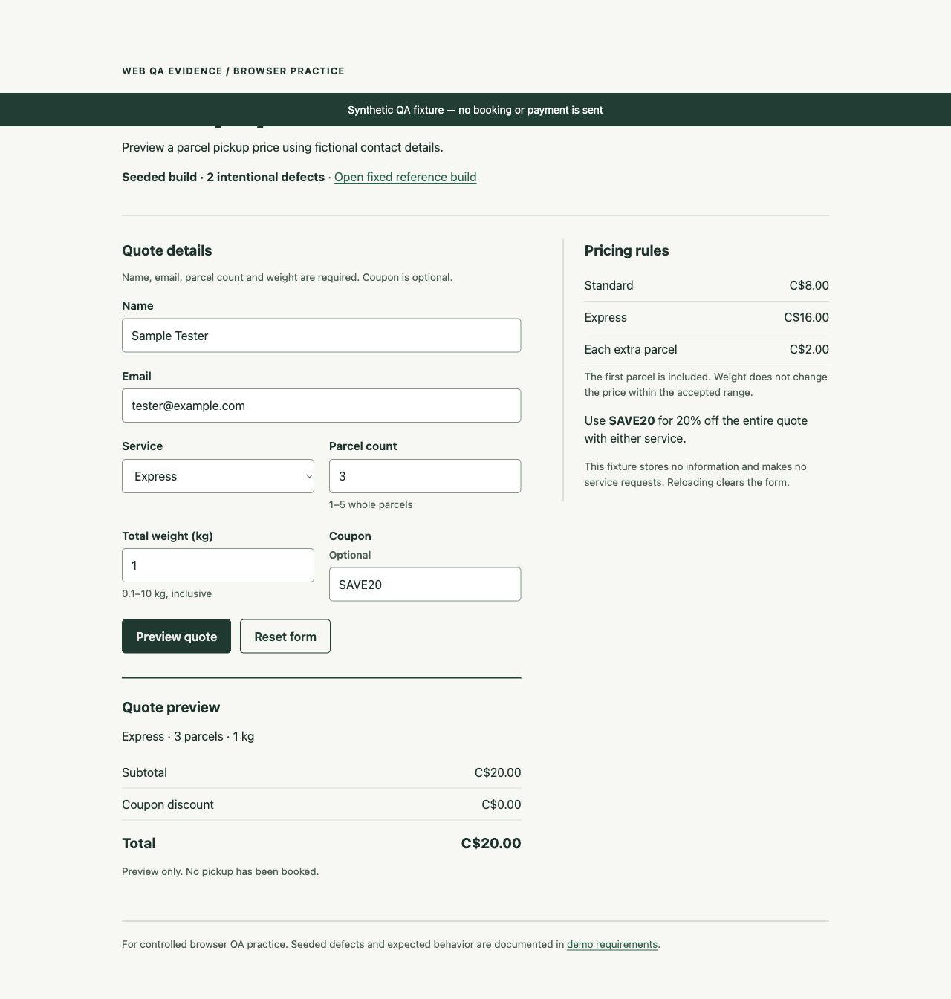

# Observed synthetic sample

An AI operator executed twelve logical cases through actual Chrome controls against the original pickup-quote fixture on November 4, 2026. Each case ran at two viewport sizes against both the seeded and corrected builds. This is a calibration exercise with known defects, not client work or proof of unknown-bug discovery.

| Build | Viewport | Pass | Fail | Blocked / unrun |
| --- | --- | ---: | ---: | ---: |
| Seeded | 1280 × 900 | 10 | 2 | 0 |
| Seeded | 390 × 844 | 10 | 2 | 0 |
| Fixed reference | 1280 × 900 | 12 | 0 | 0 |
| Fixed reference | 390 × 844 | 12 | 0 | 0 |

The two seeded defect types are a missed Express discount (C$20 displayed instead of C$16) and loss of the selected parcel count after an email validation error (3 becomes 1). Each reproduced at both widths. Four failed execution rows therefore represent two defect types. All 24 fixed-reference checks passed in this scope.

The seeded Express coupon result is shown below; [the matching fixed reference](../examples/evidence/fixed-desktop-C07.jpg) displays C$16.

- [Portable HTML report](../examples/pickup-report/report.html): download the repository and open locally; GitHub displays HTML source.
- [CSV ledger](../examples/pickup-report/cases.csv), [report input](../examples/pickup-observed.json), and [raw observations/provenance](../examples/observations.json).
- [Expected fixture behavior and seeded defects](demo-requirements.md).
- [Short user-flow handoff](pickup-flow-guide.md).

The retained observations were recorded from 23:51:32.518 to 23:53:59.118 UTC. Environment: Chrome 156.0.8078.80, macOS 26.5.2. The fixture SHA-256 is `c420375941097f3f66d26c73f161c77ec3b12e63cb847f0d07166e0678367359`, from commit `cc864bf4110bca6b5216c60546470dc5ff9a0cf1`.

Method: reset between cases, enter the recorded fictional inputs, click Preview quote, read the displayed result/errors and control values, and capture screenshots for the two seeded issues and their corrected reference states. Viewport dimensions were checked from the rendered document; no horizontal overflow was observed at the two tested widths. Images are original browser JPEG bytes; filenames were corrected to match their actual format without changing the images. Earlier exploratory runs were superseded by the retained final-file results.

Coverage excludes physical phones, other browsers, backend delivery, authentication, real bookings/payments, load, security audit, accessibility certification and complete business-rule coverage. The sample contains no customer or purchase. A passing reference build is not a production release certification.
